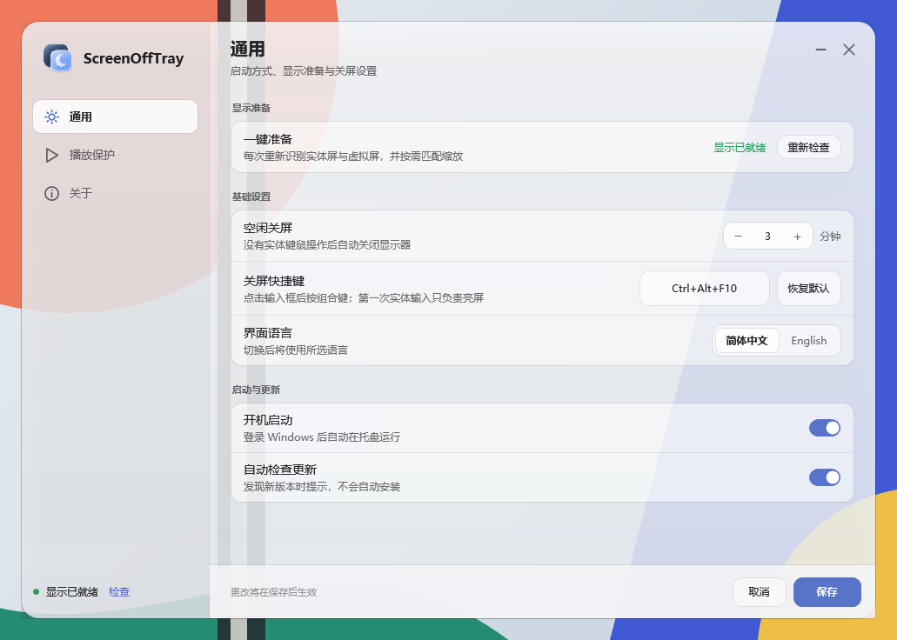

> ScreenOffTray 0.2.0：设置界面升级为独立的 Pane 风格 WPF 进程，提供几何、暖白和黑色三种外观，同时保留原有驱动、关屏、输入恢复、播放保护和显示准备流程。

# ScreenOffTray

[English](README_EN.md)

**关掉显示器，让程序继续运行。**

适合使用 OLED 显示器、希望离开时关屏，同时保留下载、计算和其他后台任务的 Windows 用户。支持快捷键立即关屏，也能按实体键鼠的空闲时间自动关屏。它不会锁屏、睡眠、休眠或关机。

**[下载 Windows x64 安装包 · v0.2.0](https://github.com/shilefumaoqu/ScreenOffTray/releases/tag/v0.2.0)**

**0.2.0** 使用独立的 `ScreenOffTray.Settings.exe` 显示 Pane 风格设置界面，后台继续负责托盘、播放保护、快捷键和关屏。旧版 `v0.1.9` 及更早安装包继续保留，不会被覆盖。

右键显示状态与常用操作的小菜单，点击“设置…”打开独立的 Pane 风格 WPF 窗口。界面分为通用、播放保护、关于三页，提供几何、暖白和黑色三种外观；默认几何，主题随设置保存。程序图标来自实际可执行文件，首页图标使用确认后的双层月亮资源。窗口可最小化，关闭后设置进程结束，后台继续在托盘运行；只有菜单“退出”结束程序。正常就绪启动保持安静；安装结束点击“完成并配置”，直接进入同一设置宿主：检查显示条件、一键完成配置、确认已就绪。失败时在同一窗口说明处理步骤；可稍后处理，未完成前不会关屏。

[English UI](docs/images/settings-en.png) · [Warm white](docs/images/settings-warm.png) · [Black](docs/images/settings-black.png)

当前面向 **Windows 10 22H2 / Windows 11 x64、一个实体显示器**，需要已安装 .NET Framework 4.8。通过虚拟显示驱动维持桌面运行；虚拟屏对部分混合显卡电脑的独显直连自动切换仍有未验证影响，需要这类功能时请先评估兼容性。

## 开始使用

1. 从 Release 下载 `ScreenOffTray-0.2.0-Setup-x64.exe`，运行安装程序并完成 Windows 管理员确认。安装包可离线使用，不下载 .NET 运行时。
2. 首次打开，在准备区点击“自动准备并启用关屏”。它会匹配实体屏的显示条件并恢复布局；准备时显示可能闪动，请暂时不要同时修改 Windows 显示设置。无法安全匹配时，关屏保持暂停。
3. 托盘右键 →“设置…”中调整关闭时间、快捷键、语言和开机启动。普通修改点击“保存”才生效，“取消”或关闭窗口放弃草稿；白名单增删即时保存。设置窗口打开期间暂缓关屏，关闭后恢复原有判断。新用户默认空闲 **10 分钟**，开机启动默认关闭。
4. 按默认 **Ctrl+Alt+F10** 或点击“立即关屏”。快捷键可在设置中的输入框重新录入并保存。

升级前先从托盘正常退出旧版，再运行安装程序。安装器不会强杀程序；设置会保留。主程序日常使用不要求管理员权限。安装器和主程序目前没有应用代码签名，驱动保留上游签名。

## 关屏后怎样亮屏

- 关屏后先有 **3 秒保护期**，期间的实体按键和鼠标按钮不唤醒，也不传给软件。
- 保护期后，松开仍按住的键或按钮，再按一次实体键盘或鼠标按钮。
- **第一次按下和松开只负责亮屏**；第二次正常作用于当前软件。
- 鼠标移动、滚轮，以及 Windows 标记为注入的模拟输入不会唤醒。未标记的内核虚拟 HID 不在识别保证内。

本工具不提供锁屏的隐私保护。需要离开时限制其他人操作电脑，请使用 Windows 锁屏。

## 自动关屏的规则

| 情况 | 行为 |
| --- | --- |
| 实体键鼠空闲达到设定时间 | 自动关屏 |
| 白名单内的程序正在播放音频 | 暂停自动关屏，并显示播放程序 |
| 播放保护结束 | 重新计时完整的关闭时间 |
| 持续无实体输入达到播放保护上限（默认 60 分钟） | 播放不再阻挡关屏；仍须达到普通空闲时间 |
| 未加入白名单的程序、静音视频或系统保亮请求 | 本身不阻挡自动关屏 |
| 手动快捷键或“立即关屏” | 不受播放保护限制 |

在现有设置面板查看“当前播放程序”，点击加入白名单。白名单使用单行下拉选择，添加和移除即时保存；取消其他设置不会撤销名单修改。新安装的名单为空，不预置浏览器或个人程序路径。只有同一个可执行文件完整路径匹配才保护；这不是对网页内容或视频画面的识别。

沿用原型的音频判断，并仅在播放器身份可靠对应、状态新鲜且明确暂停时过滤暂停项目，避免网易云暂停后仍误报。音频状态不可读取时暂停自动关屏并说明原因；不能保证所有播放器或纯静音视频的识别。播放上限可关闭，时间从最后一次实体输入计算，不是从点击播放开始计算。工具不会撤销其他应用的系统请求。

## 设置与更新

中文和 English 可切换。关闭时间、快捷键、语言、开机启动及自动检查更新选项都会保存。正常启动不会重复弹出准备界面，准备和诊断入口在设置面板内。

设置面板提供版本号、“检查更新”和“自动检查更新”开关。更新源为 `shilefumaoqu/ScreenOffTray` 的 GitHub Releases：自动检查默认开启，只读取稳定版本并提示下载入口，不自动安装或结束程序。更新成功后保留原有设置；旧版 Release 和安装包保持独立。

## 开发与验证

项目采用 **.NET Framework 4.8 / C# 5**：托盘和后台为 WinForms，设置窗口为独立 WPF 进程，无需额外运行时库。双击根目录 `打包安装版.cmd` 可构建离线安装包；首次构建会下载并校验固定版本的构建工具。详见[构建与验证](docs/构建与验证.md)。

历史验证见[验证与限制](docs/验证与限制.md)，本版定向检查及尚未验证项见[版本验证](docs/版本验证.md)。隔离测试不等于实机长期稳定性。版本变化见[发布说明](RELEASE_NOTES.md)。

## 驱动与许可

本项目源码及自有资源采用 [MIT](LICENSE)。虚拟显示驱动来自 [VirtualDrivers/Virtual-Display-Driver · 25.7.23](https://github.com/VirtualDrivers/Virtual-Display-Driver/releases/tag/25.7.23)，沿用原始 INF/DLL/CAT、签名及其 [MIT 许可](Licenses/Virtual-Display-Driver-MIT.txt)。安装包不包含 VDD Control、DevCon 或音频驱动。[第三方材料与哈希](Licenses/第三方材料说明.md)。

遇到问题可[提交 Issue](https://github.com/shilefumaoqu/ScreenOffTray/issues)。请说明系统版本、显示器数量和暂停原因，分享日志前遮去个人路径与设备信息。
