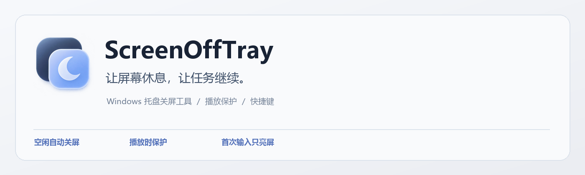
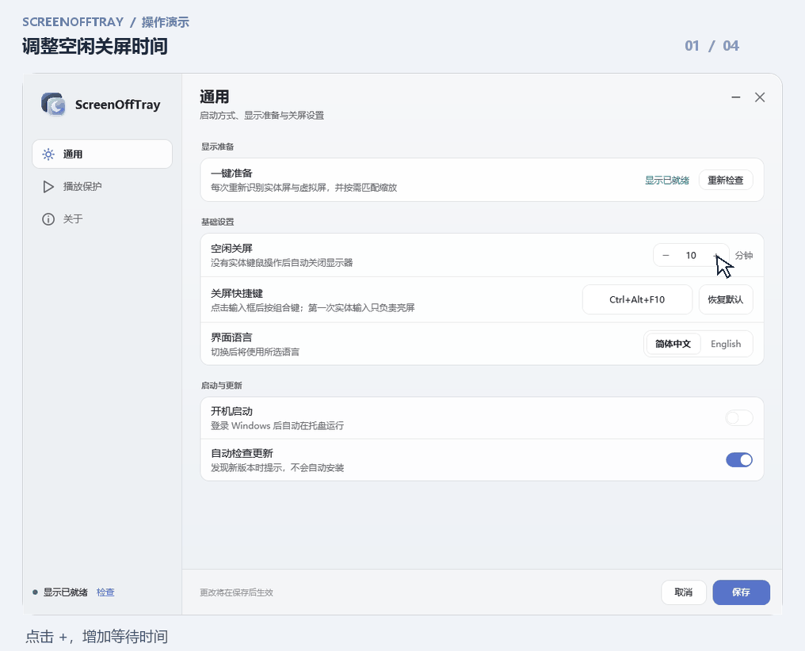
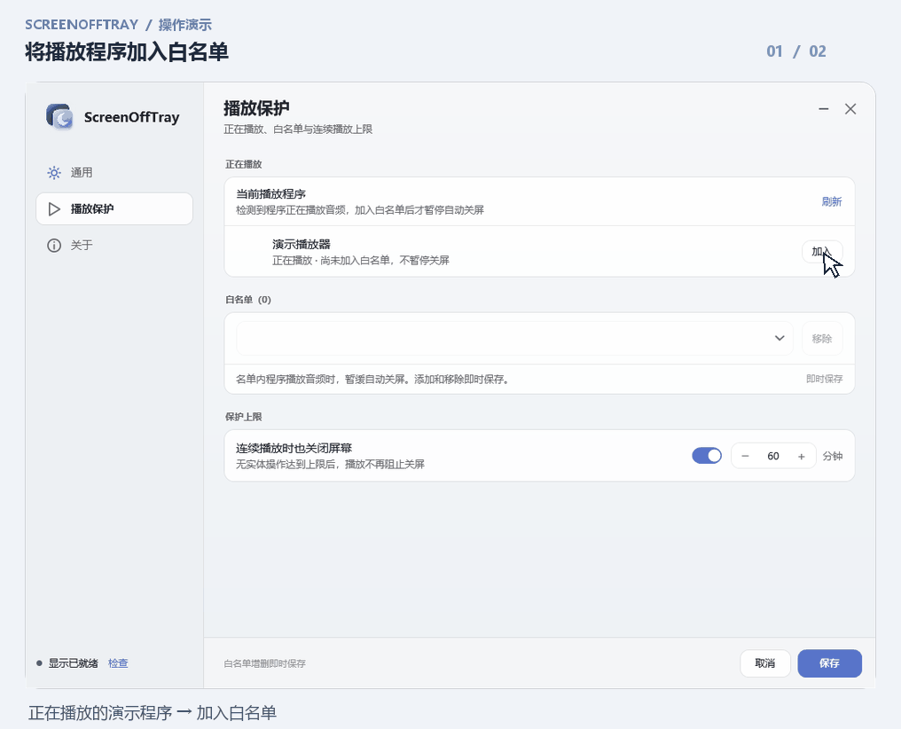
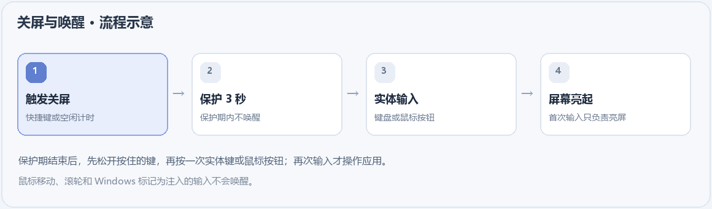
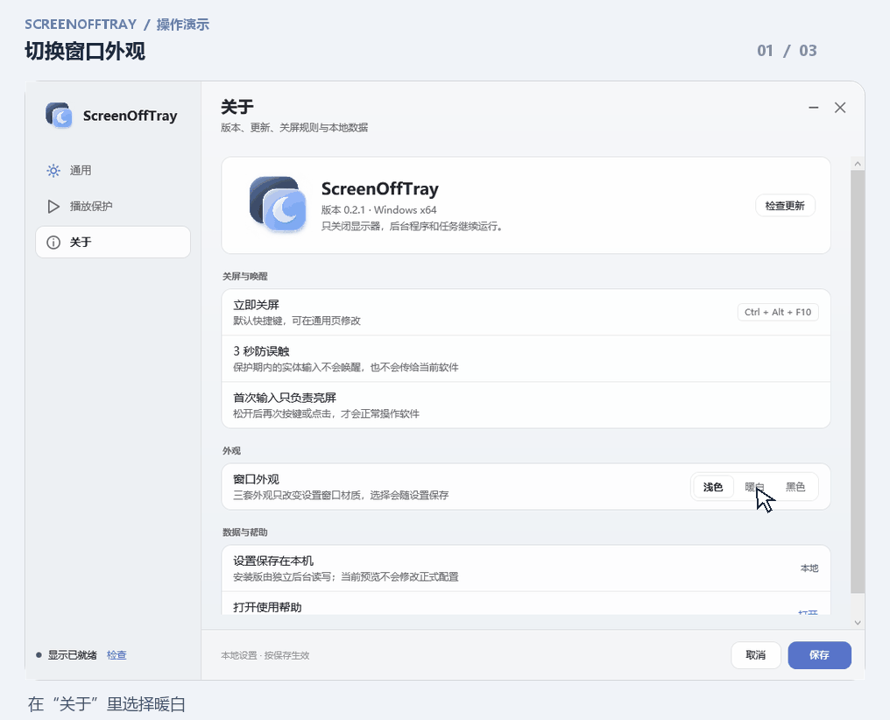

# ScreenOffTray

[English](README_EN.md) · [下载 Windows 安装包](https://github.com/shilefumaoqu/ScreenOffTray/releases/tag/v0.2.1) · [反馈问题](https://github.com/shilefumaoqu/ScreenOffTray/issues)

**关掉显示器，让程序继续运行。**

ScreenOffTray 是一款 Windows 托盘工具：离开时按快捷键关屏，或让它在键鼠空闲后自动关屏；下载、计算和其他后台任务继续运行。它不会锁屏、睡眠、休眠或关闭电脑。

适用于 Windows 10 22H2 / Windows 11 x64、一个实体显示器，需要 .NET Framework 4.8。

## 它能帮你做什么

- **按你的习惯关屏**：使用快捷键立即关屏，或设置空闲时间自动关屏。
- **正在听的内容不中断**：将播放程序加入白名单，播放音频时暂缓自动关屏；手动关屏仍然可用。
- **回来时安心亮屏**：保护期后第一次实体按键或鼠标点击只负责唤醒，避免误触正在运行的软件。

## 看看怎么用

> 演示使用正式设置界面的真实控件，在隔离测试桌面自动触发并逐帧截图；鼠标指针与点击圆环为后期标注，保存结果和播放状态由模拟后台返回。演示没有修改正式设置，也没有实际控制显示器。

### 1. 调整空闲关屏时间

在「通用」里增减分钟数，点击「保存」应用普通设置；也可以在这里录入自己的快捷键。新用户默认空闲 10 分钟、快捷键为 `Ctrl+Alt+F10`。

### 2. 将播放程序加入保护

「播放保护」会列出检测到的播放程序。点击「加入」后，这个程序播放音频时会暂缓自动关屏。名单增删即时保存，与其他设置的「保存／取消」分开。

保护上限默认 60 分钟，以最后一次实体输入开始计算；到达上限后，播放不再阻挡关屏，普通空闲条件仍须满足。名单按程序完整路径匹配，不识别网页画面或静音视频。

### 3. 关屏后如何亮屏

上图是**流程示意**，不是实机关屏录像。关屏后有 3 秒保护期；结束后先松开仍按住的键或按钮，再按一次实体键盘或鼠标按钮。第一次按下与松开只负责亮屏，下一次输入才正常传给软件。

鼠标移动、滚轮和 Windows 标记为注入的模拟输入不会唤醒；未标记的内核虚拟 HID 不在识别保证内。ScreenOffTray 不提供隐私锁定，需要限制他人操作时请使用 Windows 锁屏。

### 4. 选择顺眼的外观

在「关于」中可选择浅色、暖白或黑色，界面支持简体中文和 English。外观随普通设置一起保存。

## 安装与开始使用

1. 从 [v0.2.1 Release](https://github.com/shilefumaoqu/ScreenOffTray/releases/tag/v0.2.1) 下载 `ScreenOffTray-0.2.1-Setup-x64.exe`，运行安装程序并完成 Windows 管理员确认。安装包可离线使用，不下载 .NET 运行时。
2. 首次配置时，在设置窗口的准备区选择「自动准备并启用关屏」。准备过程可能闪屏；请不要同时修改 Windows 显示设置。无法安全匹配时，关屏保持停用并显示原因。
3. 从托盘右键打开设置，调整时间、快捷键和语言。普通设置点击「保存」才生效；关闭窗口或「取消」放弃普通草稿。设置窗口打开期间暂缓关屏。
4. 需要立即关屏时，使用 `Ctrl+Alt+F10` 或托盘菜单中的「立即关屏」。关闭设置窗口后，后台继续运行；要退出程序，请使用托盘菜单的「退出」。

升级前先从托盘正常退出旧版；安装器不会强杀程序，并保留已有设置。日常运行不要求管理员权限。安装器和主程序目前没有应用代码签名；驱动保留上游签名。

## 播放保护与边界

| 情况 | 自动关屏行为 |
| --- | --- |
| 已加入名单的程序正在播放音频 | 暂缓自动关屏 |
| 播放保护结束 | 重新计满设定的空闲时间 |
| 音频状态无法可靠读取 | 暂缓自动关屏并说明原因 |
| 未加入名单的程序、静音视频或系统保亮请求 | 本身不阻挡自动关屏 |
| 使用快捷键或托盘菜单手动关屏 | 不受播放保护限制 |

播放器暂停过滤仅在身份匹配可靠、状态新鲜且明确暂停时生效，不能保证识别所有播放器。新安装的名单为空，保护上限可以关闭。工具不会撤销其他应用的系统请求。

通过虚拟显示驱动维持桌面运行；对部分混合显卡电脑的独显直连自动切换仍存在未验证影响。具体限制与历史测试见 [验证与限制](https://github.com/shilefumaoqu/ScreenOffTray/blob/main/docs/验证与限制.md)；隔离演示不等于实机长期稳定性验证。

## 更新、开发与许可

设置中可以检查更新；自动检查默认开启，只提示稳定版本下载入口，不会自动安装或退出程序。旧版安装包保留在 [Releases](https://github.com/shilefumaoqu/ScreenOffTray/releases)。

项目使用 .NET Framework 4.8 / C# 5，后台采用 WinForms，设置窗口为独立 WPF 进程。构建方法见 [构建与验证](https://github.com/shilefumaoqu/ScreenOffTray/blob/main/docs/构建与验证.md)，本版检查见 [版本验证](https://github.com/shilefumaoqu/ScreenOffTray/blob/main/docs/版本验证.md)。

本项目源码及自有资源采用 [MIT 许可](https://github.com/shilefumaoqu/ScreenOffTray/blob/main/LICENSE)。虚拟显示驱动来自 [Virtual Display Driver 25.7.23](https://github.com/VirtualDrivers/Virtual-Display-Driver/releases/tag/25.7.23)，保留原始签名及其 [MIT 许可](https://github.com/shilefumaoqu/ScreenOffTray/blob/main/Licenses/Virtual-Display-Driver-MIT.txt)。安装包不包含 VDD Control、DevCon 或音频驱动。

遇到问题可[提交 Issue](https://github.com/shilefumaoqu/ScreenOffTray/issues)。请附上系统版本、实体显示器数量和错误原因；分享日志前遮去个人路径及设备信息。
