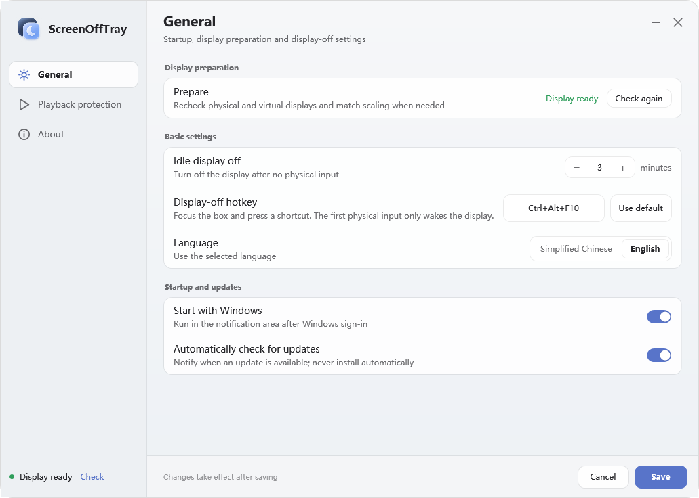

> ScreenOffTray 0.2.1 brings Settings and Setup into one Pane-inspired neutral frosted-glass language with Light, Warm white and Black appearances. Existing driver, display-off, input recovery, playback protection and display preparation behavior is retained.

# ScreenOffTray

[简体中文](README.md)

**Turn off your display while applications keep running.**

A Windows tray utility for OLED users who want the screen off while downloads, calculations and background work continue. Turn it off immediately with a shortcut, or automatically after physical keyboard and mouse inactivity. It does not lock, sleep, hibernate or shut down Windows.

**[Download the Windows x64 installer · v0.2.1](https://github.com/shilefumaoqu/ScreenOffTray/releases/tag/v0.2.1)**

**0.2.1** removes the reference sample's colored geometry wallpaper and the display-only backdrop, outer margin and shadow from Settings, leaving only the neutral blue-gray rounded frosted-glass window. Opaque top-level misted surfaces also remove transparent-window content ghosting. Setup uses matching light and dark misted backgrounds, glass cards and the same layered-moon mark. `ScreenOffTray.Settings.exe` still owns the window, while the background process owns tray state, playback protection, hotkeys and display off. `v0.2.0`, `v0.1.9` and older installers remain available.

Right-click opens a small menu with status and quick actions. Settings opens a separate Pane-styled WPF window with General, Playback protection and About pages. Light, Warm white and Black appearances are available; Light is the default and the choice is saved with the other settings. Application icons come from their executable files, while Settings and Setup share the supplied layered-moon mark. Closing Settings ends only that UI process; the tray application keeps running. Ready startup remains silent. The installer continues into the same Settings host: check displays, complete preparation, and confirm readiness. Users can defer action; display off stays disabled until preparation is verified.

[Chinese UI](docs/images/settings-zh.png) · [Warm white](docs/images/settings-warm.png) · [Black](docs/images/settings-black.png)

Targets **Windows 10 22H2 / Windows 11 x64 with one physical display** and requires .NET Framework 4.8 already installed. A virtual display driver keeps the desktop running. Its impact on automatic direct-discrete-GPU display switching on hybrid-GPU laptops remains unverified; evaluate compatibility if your workflow requires that feature.

## Get started

1. Download `ScreenOffTray-0.2.1-Setup-x64.exe` from the Release, run it, and complete the Windows administrator prompt. Setup works offline and does not download the .NET runtime. The wizard keeps native keyboard and DPI behavior while using a neutral misted background, fine highlight edges and glass cards.
2. On first launch, choose “Prepare and enable display off”. Preparation matches the physical display conditions and restores the layout. The display may flicker; avoid changing Windows display settings at the same time. If safe matching fails, display-off stays paused.
3. Right-click the tray icon → Settings to change the timeout, shortcut, language and startup preference. Save applies ordinary drafts; Cancel or closing the window discards them. Whitelist edits are saved immediately. Display off is deferred while Settings is open and resumes its existing rules after closure. New users start with **10 minutes** and startup disabled.
4. Press **Ctrl+Alt+F10**, or choose “Turn off now”. To customize the shortcut, focus its field in Settings, press a combination, release it and save.

Before upgrading, exit the previous version normally from the tray. Setup does not force-close it, and existing settings are retained. Everyday use does not require administrator privileges. The application and installer currently have no application code signature; the bundled driver retains its upstream signature.

## Waking the display

- A **3-second guard** follows display-off. Physical key and mouse-button presses during it neither wake the display nor reach applications.
- After the guard, release any held key or button, then press a physical keyboard key or mouse button.
- **The first press and release only wake the display.** The next press works normally in the current application.
- Mouse movement, scrolling and input marked as injected by Windows do not wake it. Unmarked kernel-level virtual HID input is outside the identification guarantee.

This is not a privacy lock. Use Windows Lock when you need to restrict other people's access to the computer.

## Automatic display-off rules

| Situation | Behavior |
| --- | --- |
| Physical input has been idle for the configured interval | Turn the display off |
| A whitelisted program is playing audio | Pause automatic off and show the program |
| Playback protection ends | Start a full timeout again |
| Physical inactivity reaches the playback cap (60 minutes by default) | Playback no longer blocks off; the normal idle threshold must also be reached |
| An unlisted program, silent video, or a system display request | Does not block automatic off by itself |
| Manual shortcut or “Turn off now” | Bypasses playback protection |

Use the current playing-program list in Settings to add an app. The saved whitelist uses a single-row dropdown. Add/remove is saved immediately; cancelling other settings does not undo it. New installs start with an empty list. Protection matches the full executable path; it does not inspect webpage content or video frames.

The existing prototype audio detection is retained. A fresh, unambiguously matched player state may suppress explicitly paused sources, addressing the NetEase pause false positive. Unavailable audio state pauses automatic off with a reason. Detection is not guaranteed for every player or silent video. The cap can be disabled and is measured from the last physical input, not the start of playback. The app does not clear other applications' system requests.

## Settings and updates

Chinese and English are available. Timeout, shortcut, language, startup and automatic update-check preferences are saved. Normal startup does not repeatedly open preparation; preparation and diagnostics are available in Settings.

Settings includes the version, “Check for updates” and an automatic-check toggle. The update source is the stable GitHub Releases feed for `shilefumaoqu/ScreenOffTray`. Automatic checks are on by default and only notify with a download link; they never install automatically or exit the app. Existing settings are retained after upgrade, and older releases remain available.

## Development and verification

Built with **.NET Framework 4.8 / C# 5**. The tray and background use WinForms, while Settings runs in a separate WPF process; no additional runtime libraries are required. Run `打包安装版.cmd` in the repository root to build the offline installer. The first build downloads and verifies pinned tools. See [Build and verification](docs/构建与验证.md) for commands and English instructions.

Historical evidence is in [Validation and limitations](docs/验证与限制.md); see [version validation](docs/版本验证.md) for targeted checks and remaining gaps. Isolated tests do not establish hardware compatibility or long-term stability. See [Release notes](RELEASE_NOTES.md).

## Driver and license

Project source and original assets use the [MIT License](LICENSE). The virtual display driver comes from [VirtualDrivers/Virtual-Display-Driver · 25.7.23](https://github.com/VirtualDrivers/Virtual-Display-Driver/releases/tag/25.7.23). The original INF/DLL/CAT, signature and [MIT license](Licenses/Virtual-Display-Driver-MIT.txt) are retained. VDD Control, DevCon and audio drivers are not bundled. [Third-party provenance and hashes](Licenses/第三方材料说明.md).

[Open an issue](https://github.com/shilefumaoqu/ScreenOffTray/issues) with your Windows version, display count and pause reason. Remove personal paths and device information before sharing logs.
