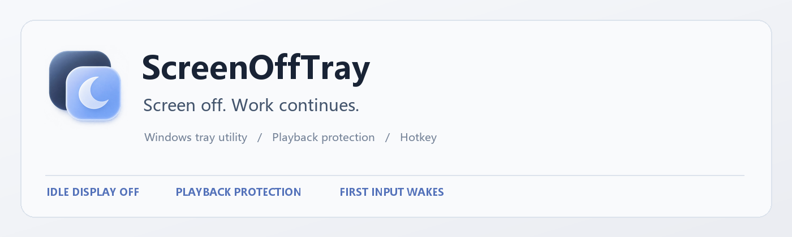
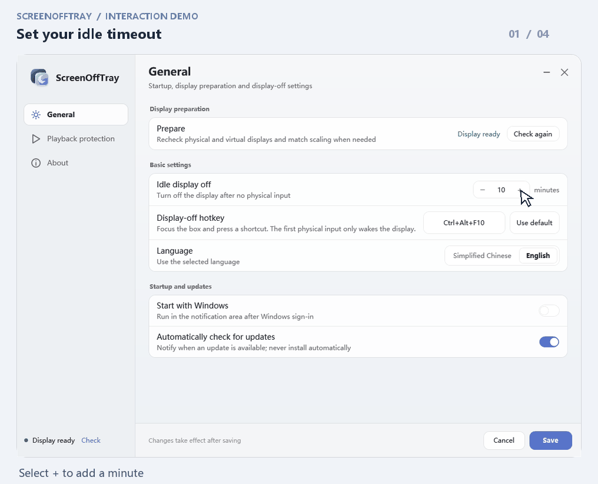
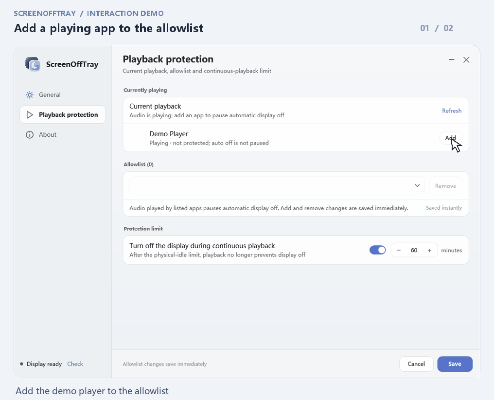
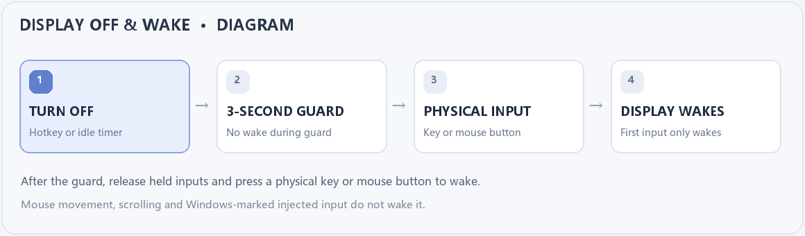
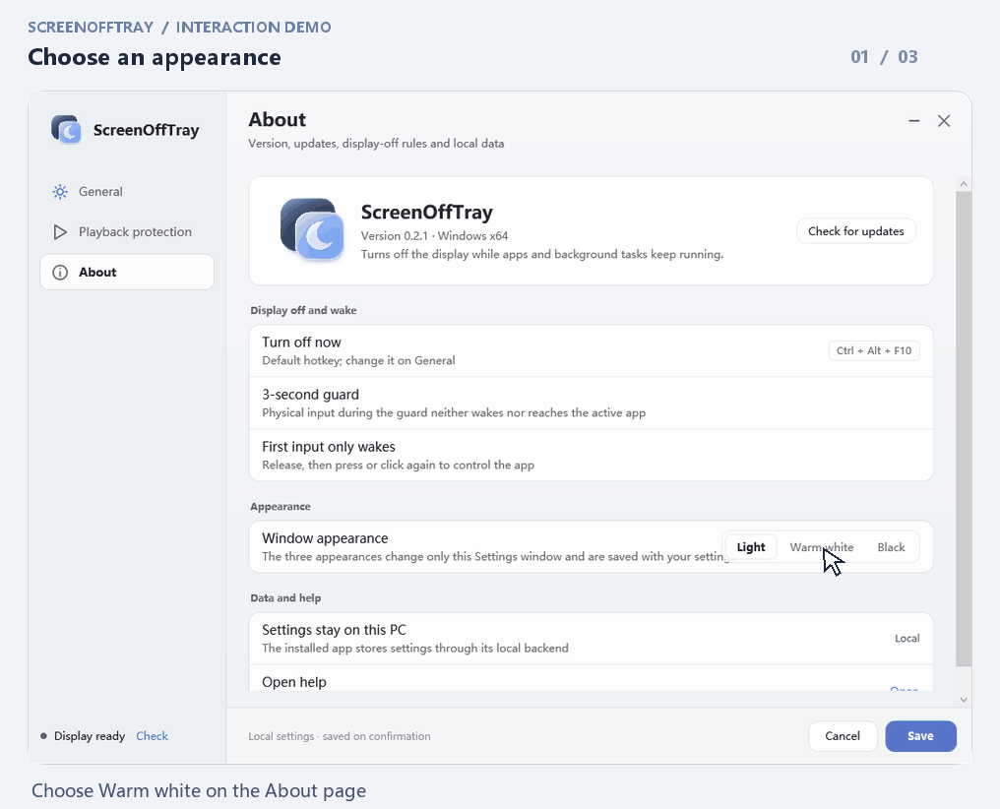

# ScreenOffTray

[简体中文](README.md) · [Download for Windows](https://github.com/shilefumaoqu/ScreenOffTray/releases/tag/v0.2.1) · [Report an issue](https://github.com/shilefumaoqu/ScreenOffTray/issues)

**Turn off the display while your applications keep running.**

ScreenOffTray is a Windows tray utility. Turn the screen off with a shortcut or automatically after keyboard and mouse inactivity while downloads, computations and other work continue. It does not lock, sleep, hibernate or shut down Windows.

Requires Windows 10 22H2 / Windows 11 x64, one physical display and .NET Framework 4.8.

## What it does

- **Turn the display off your way:** use a shortcut immediately or set an idle timeout.
- **Keep listening:** whitelist a playing app to pause automatic display-off while it plays audio. Manual display-off remains available.
- **Wake without an accidental click:** after the guard period, the first physical key or mouse click wakes the screen instead of reaching the active app.

## See how it works

> The demonstrations use actual Settings controls on an isolated test desktop, triggered automatically and captured frame by frame. The pointer and click rings are annotations; save and playback results come from a simulated backend. No production settings or physical displays were changed.

### 1. Set an idle timeout

Adjust the minutes under General and select Save to apply ordinary settings. You can also record your own shortcut here. New users start with a 10-minute timeout and `Ctrl+Alt+F10`.

### 2. Protect a playing application

Playback protection lists detected playing applications. Add one to the whitelist to pause automatic display-off while it plays audio. Adding or removing a whitelist entry is saved immediately, independently of the ordinary Save and Cancel buttons.

The protection cap defaults to 60 minutes, measured from the last physical input. When it expires, playback no longer blocks display-off, although the normal idle threshold must still be met. Entries match the executable's full path; the app does not inspect webpages or silent video frames.

### 3. Wake the screen

This is an **illustrated sequence**, not a recording of a physical display. A 3-second guard follows display-off. Afterwards, release held keys or buttons, then press a physical keyboard key or mouse button. The first press and release only wake the display; the next input reaches the application normally.

Mouse movement, scrolling and input marked as injected by Windows do not wake it. Unmarked kernel-level virtual HID is outside the identification guarantee. This utility is not a privacy lock; use Windows Lock to restrict access.

### 4. Choose an appearance

Choose Light, Warm white or Black under About. Simplified Chinese and English are available. Appearance changes are saved with ordinary settings.

## Install and get started

1. Download `ScreenOffTray-0.2.1-Setup-x64.exe` from [v0.2.1 Release](https://github.com/shilefumaoqu/ScreenOffTray/releases/tag/v0.2.1), run it and approve the Windows administrator prompt. Setup works offline and does not download the .NET runtime.
2. During first-time setup, choose “Prepare and enable display off” in Settings. The display may flicker; avoid changing Windows display settings during preparation. If safe matching fails, display-off stays disabled and a reason is shown.
3. Open Settings from the tray menu to adjust the timeout, shortcut and language. Save applies ordinary drafts; Cancel or closing the window discards them. Display-off is deferred while Settings is open.
4. Press `Ctrl+Alt+F10` or choose “Turn off now” in the tray menu. Closing Settings leaves the background app running; use “Exit” in the tray menu to quit it.

Before upgrading, exit the previous version normally from the tray. Setup does not force-close it and keeps existing settings. Everyday use does not require administrator rights. The application and installer are not code-signed; the driver retains its upstream signature.

## Playback protection and limits

| Situation | Automatic display-off |
| --- | --- |
| A whitelisted application is playing audio | Paused |
| Playback protection ends | The full idle timeout starts again |
| Audio state cannot be read reliably | Paused with an explanation |
| An unlisted app, silent video or system display request | Does not block automatic display-off by itself |
| Manual shortcut or tray command | Bypasses playback protection |

Explicitly paused players are filtered only when their identity is reliably matched and the state is fresh; not every player is guaranteed to be detected. The initial whitelist is empty, and the cap can be disabled. The app does not clear other applications' system requests.

The app uses a virtual display driver to keep the desktop running. Effects on automatic discrete-GPU direct-display switching on some hybrid-GPU machines remain unverified. See [validation and limitations](https://github.com/shilefumaoqu/ScreenOffTray/blob/main/docs/验证与限制.md); an isolated demonstration does not establish real-hardware or long-term stability.

## Updates, development and license

Settings can check for stable updates. Automatic checks are enabled by default and only provide a download link; they never install or quit the app. Older installers remain available in [Releases](https://github.com/shilefumaoqu/ScreenOffTray/releases).

Built with .NET Framework 4.8 / C# 5, with a WinForms background app and a separate WPF Settings process. See [build and verification](https://github.com/shilefumaoqu/ScreenOffTray/blob/main/docs/构建与验证.md) and [version validation](https://github.com/shilefumaoqu/ScreenOffTray/blob/main/docs/版本验证.md).

Project source and original assets use the [MIT License](https://github.com/shilefumaoqu/ScreenOffTray/blob/main/LICENSE). The virtual display driver is [Virtual Display Driver 25.7.23](https://github.com/VirtualDrivers/Virtual-Display-Driver/releases/tag/25.7.23), retaining its original signature and [MIT license](https://github.com/shilefumaoqu/ScreenOffTray/blob/main/Licenses/Virtual-Display-Driver-MIT.txt). VDD Control, DevCon and audio drivers are not bundled.

[Open an issue](https://github.com/shilefumaoqu/ScreenOffTray/issues) with your Windows version, number of physical displays and error reason. Remove personal paths and device information before sharing logs.
