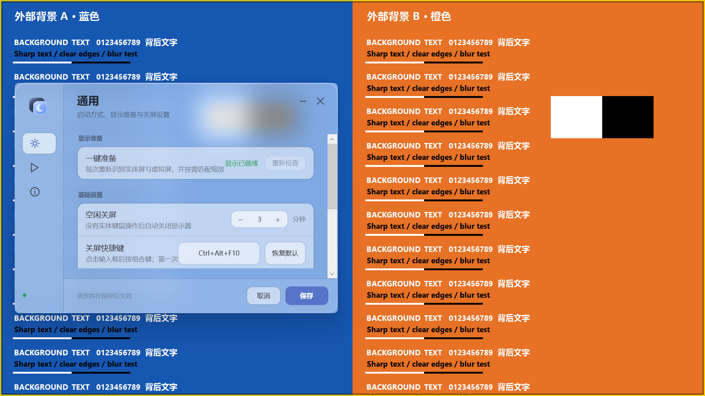
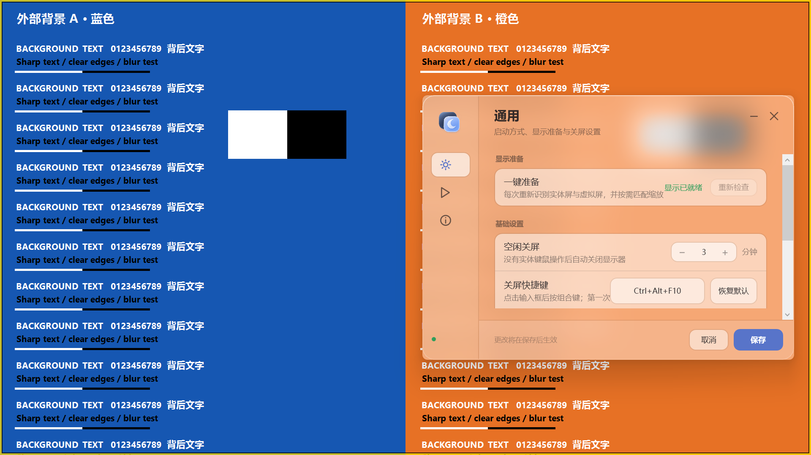

# 0.2.4 原生玻璃与验证

设置窗口采用 Windows DWM Desktop Acrylic，替代接近实色的透明窗口表面。保留 WPF/.NET Framework 4.8、页面结构、主题与设置接口，无额外运行时依赖。

Windows 11 build 22621 及以上可用原生材质；系统关闭透明效果、高对比度或 API 不支持时显示实色回退。回退不算玻璃效果通过。Windows 10 的实际回退呈现尚未实机复验。

## 双背景实拍

在 Windows 11 build 26300 上，将同一个浅色设置窗口移到外部蓝、橙背景，保持尺寸、主题与固定展示数据不变。两张为原始桌面截图，背景不是软件资产。窗外黑白块是硬边，窗内明显柔化；窗口色调随背景变化，自己的文字保持清晰。

测试采用真实设置程序、隔离展示后台，不启动关屏控制、全局输入钩子或驱动操作，也不修改正式用户设置。深色双背景实拍、实际跨 DPI 拖动和长期资源观察不在本次三项核心效果通过的结论内。

## 验证范围

- 79 项中英文隔离布局、主题、附件/回退、更新动作及 DPI 裁切时序检查通过。DPI 检查模拟消息顺序，不改变系统缩放，不代替跨 DPI 实机验收。
- 三次真实设置进程的隔离启动、呈现与正常关闭通过；不代表安装验收或 DWM 帧率测量。
- 窗口区域在尺寸/DPI 更新后重建，成功设置的 GDI 区域交由系统所有，关闭时解除消息回调。
- 驱动、显示准备、关屏、输入恢复、音频及快捷键逻辑未改；本轮不覆盖安装本机正式程序。

## 与 Pane 的关系

参考 Pane 固定提交的 [SceneB](https://github.com/LBEILC/Pane/blob/054eb91b3365dd9834680ba26d7d21bb7757b23b/src/Pane.App/Hosting/SceneB.cs) 与 [GlassPanel](https://github.com/LBEILC/Pane/blob/054eb91b3365dd9834680ba26d7d21bb7757b23b/src/Pane.App/Hosting/GlassPanel.cs)，保留中性层级、控件填充、四段高光与雾蓝点缀。本项目使用系统 [Desktop Acrylic](https://learn.microsoft.com/en-us/windows/win32/api/dwmapi/ne-dwmapi-dwm_systembackdrop_type)，没有引入 Pane 的 WinUI 宿主和效果 DLL；饱和度、着色与模糊由 Windows 决定，不声称参数或像素完全相同。安装向导仍是原生 Inno 雾面视觉近似，不是本次实时背景合成窗口。

## 更新行为

旧版查询 GitHub 最新稳定 Release；发现 0.2.4 后显示新版，并提供可信安装包入口。下载仍由浏览器处理，用户正常退出旧版、运行 Setup 才会安装；检查更新不会自行覆盖程序。已保存的设置与原有升级门禁沿用。
